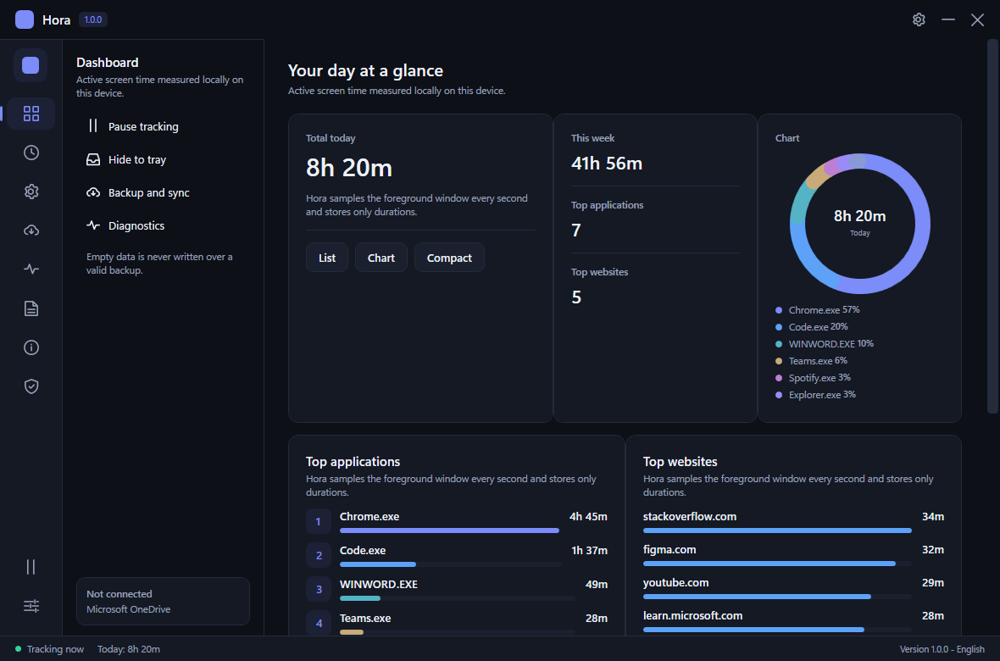
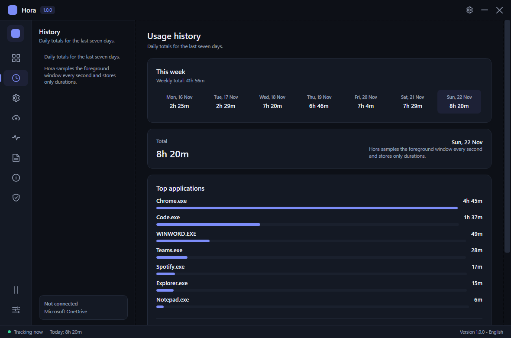
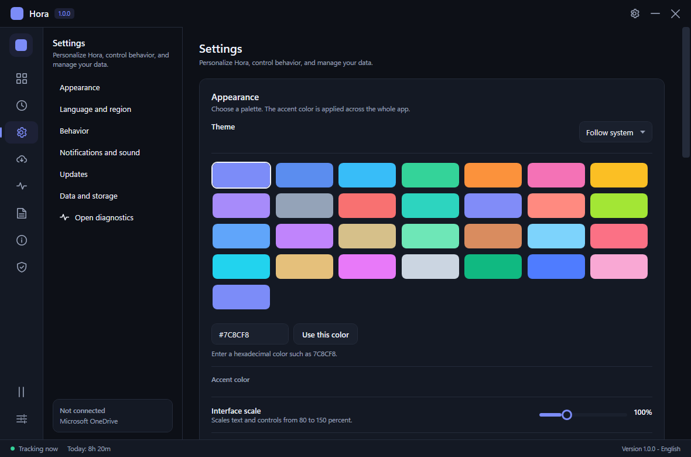
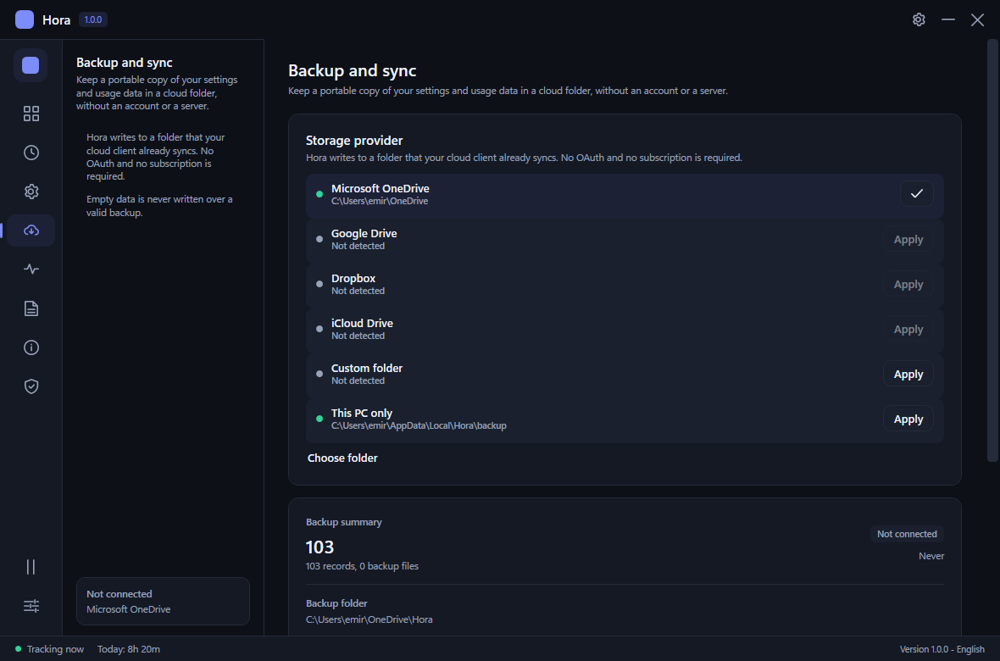
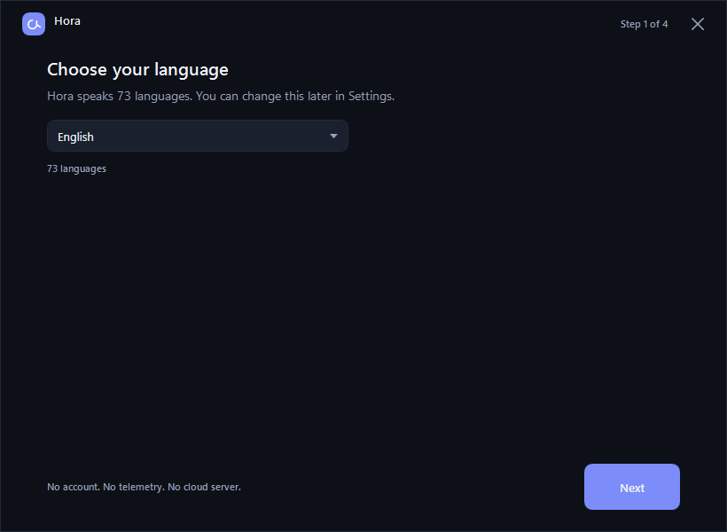
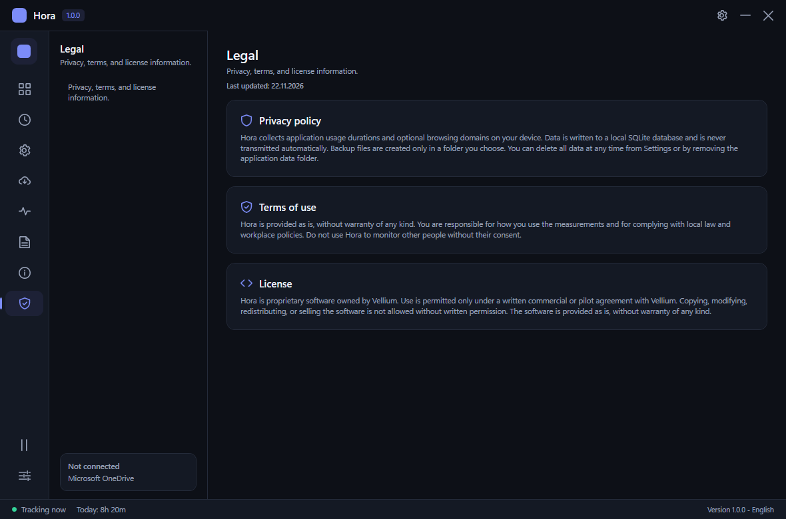

<div align="center">

<a href="https://vellium.dev" target="_blank" rel="noopener noreferrer">
  
</a>

<br /><br />

# Hora - Local-First Screen Time Tracking for Windows

</div>

---

<div align="center">

[](#english-version)
&nbsp;&nbsp;&nbsp;&nbsp;
[](#turkish-version)

</div>

---

<div align="center">

[](https://github.com/emirtdede/hora/actions/workflows/ci.yml)


</div>

---

<a id="english-version"></a>
# English Version

<div align="center">
  
  <h3>Hora - Know where your screen time goes, without sending it anywhere</h3>
  <p><em>Per-second application and website tracking, 28 themes, 73 languages, and a serverless backup folder that follows you across PCs</em></p>
  <p><strong>Developed &amp; Published by <a href="https://vellium.dev">Vellium</a></strong></p>
</div>

<br>

## Project Overview

**Hora (`v1.0.0`)** is a local-first Windows desktop application that measures how long you spend in each application and on each website. It is built with **C# 12**, **.NET 8**, and **WPF**, and it stores everything in a local **WAL-mode SQLite** database. There is no account, no telemetry, no cloud server, and no background upload.

The tracker samples the foreground window once per second and keeps only durations. Idle time, screen lock, sleep, fullscreen media, and meetings are handled as separate, explicit states, so a paused video does not silently inflate your work time. Domain-level detail is derived from browser window titles, and sensitive titles are detected and discarded before they reach the database.

The application is designed as a product, not a prototype: first-run wizard, tray integration, global hotkey, jump list, Windows light/dark following, 28 color palettes plus a custom hex accent, 73 complete language catalogs, an updater that respects Microsoft Store delivery, backup rotation with corruption recovery, and a diagnostics page with redacted logs.

> **Documentation:** architecture, data model, localization, and runbooks are indexed in [`docs/README.md`](docs/README.md).

---

## Screenshots

| Dashboard | History |
|---|---|
|  |  |

| Settings | Backup |
|---|---|
|  |  |

| First-run wizard | Legal and privacy |
|---|---|
|  |  |

The complete gallery, including diagnostics, docs, and About, lives in [`docs/screenshots/`](docs/screenshots/README.md).

---

## Key Features

### Per-Second Tracking That Understands Context
- Foreground window sampling every second with a single logical owner per state.
- **Idle** after 60 seconds without input, **Locked** on `Win+L`, **Suspended** across sleep and resume.
- **Fullscreen media** and **meeting** detection so long videos and calls are not counted as idle.
- Explicit priority: Suspended, then Locked, then Meeting, then Idle, then Active.
- Buffered in memory and flushed to SQLite in batches; a crash loses at most a few seconds.

### Application and Website Breakdown
- Top applications for today, the last seven days, and any historical day.
- Domain extraction from the window title of Chrome, Edge, Firefox, Brave, Opera, and Vivaldi, including multi-part suffixes such as `example.co.uk`.
- Donut chart, ranked lists, and a weekly activity strip.
- History page with a day picker and per-day totals.

### Privacy by Construction
- Password manager, banking, and payment titles are detected and replaced before storage.
- Card-number patterns are filtered from titles.
- Logs are redacted: titles, domains, and user paths never reach disk.
- No network request carries usage data. The updater only reads a public release feed.

### 28 Themes, Custom Accent, and Accessibility
- 28 curated palettes across light and dark modes, plus a validated custom hex accent.
- Contrast foreground is computed from the accent, never hardcoded.
- Interface zoom and text scale from 90% to 150%, independent of DPI.
- Reduced-motion and high-contrast preferences, full keyboard navigation, and RTL mirroring.

### 73 Complete Languages
- Every catalog is fully translated, with zero English fallback strings, zero em or en dashes, and zero emoji.
- Placeholder parity is enforced by `scripts/check-locales.mjs` and by the test suite.
- Right-to-left layout for Arabic, Hebrew, Persian, and Urdu.
- First-run language step with native names and instant preview.

### Serverless Backup Across Devices
- Provider detection: `OneDriveConsumer`, then `OneDrive`, then `OneDriveCommercial`, then `~/OneDrive`, plus Google Drive, Dropbox, iCloud, and a custom folder.
- One folder per account: `<root>/Hora`.
- Files: `hora-sync.json` (latest), `hora-previous.json` (rotation), and `hora-backup-YYYY-MM-DD.json` with 15-day retention.
- Atomic write with copy fallback, debounced writes, and a flush on close.
- Recovery chain: sync, then previous, then the newest daily file.
- A good backup is never replaced by an empty payload; a format-recovery modal explains what happened.
- Writes are suspended when the folder is unreachable, then resumed when it returns.

### Windows Integration
- Start with Windows, silently in the tray.
- Global hotkey `Ctrl+Alt+H` with a validated preset list.
- System, Light, and Dark appearance that follows the Windows theme live.
- Taskbar jump list for open and settings.
- One-click system information copy for support.
- Single instance: a second launch focuses the running window.

### Enterprise-Grade Engineering
- Three projects: `Hora.Core` (pure logic), `Hora.Storage` (SQLite and files), `Hora.UI` (WPF shell).
- Warnings are errors, analyzers run at the latest level, and builds are deterministic.
- xUnit suite covering backup rotation, corruption recovery, empty-payload protection, settings sanitizing, tracking decisions, aggregation, privacy, domain extraction, hotkey validation, and localization gates.
- GitHub Actions CI on every push and pull request, and a tag-driven release workflow.

---

## Tech Stack

### Runtime and UI
- C# 12, .NET 8 (`net8.0-windows10.0.17763`), WPF with Windows Forms interop for the tray.
- Per-monitor V2 DPI awareness, declared once at the project level.
- Custom vector styles and 42 icon geometries; no bitmap assets in the interface.

### Data and Security
- SQLite with WAL mode for usage rows.
- `System.Text.Json` settings and backup files.
- Redacted rotating file log.
- No secrets in source, no telemetry endpoint, no remote code execution path.

### Build, Test, and Release
- `dotnet build Hora.slnx` and `dotnet test Hora.slnx`.
- Node.js scripts for locale generation, locale gating, and icon generation.
- NSIS 3 installer with a multi-language page, per-user install, and clean uninstall.
- GitHub Actions: `ci.yml` and `release.yml`.

---

## Project Structure

```text
Hora/
  assets/                     Application icon and brand artwork
  docs/                       Architecture, runbooks, reports, screenshots
  installer/hora.nsi          NSIS setup definition
  installer/generated/        Installer strings generated from the catalogs
  scripts/
    check-locales.mjs         Localization quality gate
    translate-locales.mjs     Catalog generator
    make-installer-languages.mjs  NSIS language block generator
    make-icon.mjs             Multi-resolution ICO generator
    build-release.ps1         Portable zip, setup exe, checksums
    capture-screenshots.ps1   Silent screenshot pass for docs/screenshots
  src/
    Hora.Core/                Pure domain logic (no Windows UI)
      Aggregation/            Tracking decisions and chart aggregation
      Browser/                Domain extraction
      Input/                  Hotkey catalog and validation
      Localization/           Translator and 73 embedded catalogs
      Logging/                Redacted file logger
      Presentation/           Duration formatting
      Privacy/                Sensitive title detection
      Theming/                28 palettes and color math
      Tracking/               Foreground, idle, fullscreen, audio, meeting, session
    Hora.Storage/             Persistence boundaries
      Backup/                 Backup format, rotation, recovery
      Db/                     SQLite usage repository
      Paths/                  App data locations
      Settings/               Settings model, sanitizing, snapshots
    Hora.UI/                  WPF shell
      Controls/               Donut chart
      Dialogs/                Prompt and close dialogs
      Platform/               Tray, hotkey, jump list, autostart, theme
      Services/               Backup, update, system info
      Theme/                  Styles and icons
      Views/                  Dashboard, history, settings, backup, diagnostics, docs, about, legal
      Wizard/                 Four-step first-run setup
  tests/Hora.Tests/           xUnit suite
  tools/Hora.Seed/            Demo data for the screenshot pipeline only
```

---

## Architecture and Boundaries

- **Core has no UI dependency.** Tracking decisions, aggregation, theming, privacy, and localization are pure and testable.
- **Storage owns the file system and SQLite.** Settings, usage rows, and backup documents cross the boundary as plain records.
- **UI composes services.** `AppContext` is the composition root; views receive it, never construct services.
- **One sampler.** `TrackingEngine` is the only component that writes usage rows, which keeps totals consistent.
- **Fail soft.** Tray, hotkey, jump list, autostart, and backup failures never block the interface; they are logged and surfaced on the diagnostics page.

---

## Storage and Data Model

| Location | Content |
|---|---|
| `%LOCALAPPDATA%\Hora\usage.db` | WAL-mode SQLite usage table |
| `%LOCALAPPDATA%\Hora\settings.json` | Interface, language, and behavior settings |
| `%LOCALAPPDATA%\Hora\logs\hora-*.log` | Redacted rotating log |
| `<backup root>\Hora\hora-sync.json` | Latest backup |
| `<backup root>\Hora\hora-previous.json` | Previous backup |
| `<backup root>\Hora\hora-backup-YYYY-MM-DD.json` | Daily snapshots, 15-day retention |

A usage row is `(date, exe, domain, seconds)`. Idle, locked, suspended, and meeting are stored as their own executable keys so they can never be confused with real applications.

---

## Installation and Usage

### Installing as an end user

1. Download `Hora-Setup-1.0.0.exe` from the releases page.
2. Run it. The installer is per-user and does not require administrator rights.
3. Choose a language on the first screen. The setup page reuses the application catalogs and exposes all 51 languages that NSIS ships a translation for; the app itself keeps 73.
4. Pick a Start menu shortcut, a desktop shortcut, and optionally start with Windows.
5. The four-step first run asks for language, theme, welcome, and tour, in that order.

To remove Hora, use Settings, Apps, or the Start menu uninstall shortcut. Usage data is kept unless you delete it from Settings.

### Prerequisites, building from source

- Windows 10 version 1809 or newer, x64.
- .NET SDK 8.0 or newer.
- Node.js 20 or newer for scripts.
- NSIS 3 for the installer.

### Run from source

```powershell
dotnet restore Hora.slnx
dotnet build Hora.slnx -c Debug
dotnet run --project src/Hora.UI/Hora.UI.csproj
```

### Tests and release gates

```powershell
dotnet test Hora.slnx -c Release
node scripts/check-locales.mjs
```

The locale gate fails on a missing key, an empty value, an em or en dash, an emoji, or a placeholder mismatch. The test suite fails on the same conditions from inside .NET.

### Build installers

```powershell
./scripts/build-release.ps1 -Version 1.0.0
```

Output:

- `dist/Hora-Setup-1.0.0.exe` (NSIS setup)
- `dist/Hora-Portable-1.0.0.zip` (self-contained portable build)
- `dist/SHA256SUMS.txt`

---

## Distribution Packages

| Package | Purpose |
|---|---|
| `Hora-Setup-1.0.0.exe` | Standard per-user installer, multi-language, optional autostart |
| `Hora-Portable-1.0.0.zip` | Self-contained folder, no installation |
| Winget manifest | `installer/winget/manifests/v/Vellium/Hora/` |
| Microsoft Store | Self-update is disabled in Store builds; the Store owns delivery |

The updater reads `https://api.github.com/repos/emirtdede/hora/releases/latest`, compares the tag with the running assembly version, and links to the release page. It never downloads or executes a package on its own.

---

## License and Publisher

Hora is proprietary software. See [`LICENSE`](LICENSE).

Publisher: **Vellium Teknoloji Anonim Sirketi** - [vellium.dev](https://vellium.dev)

Sponsor: [github.com/sponsors/emirtdede](https://github.com/sponsors/emirtdede)

---

<a id="turkish-version"></a>
# Turkce Versiyon

<div align="center">
  
  <h3>Hora - Ekran surenizin nereye gittigini, hicbir yere gondermeden gorun</h3>
  <p><em>Saniye bazli uygulama ve site takibi, 28 tema, 73 dil ve bilgisayarlar arasi sunucusuz yedekleme klasoru</em></p>
  <p><strong><a href="https://vellium.dev">Vellium</a> tarafindan gelistirildi ve yayinlandi</strong></p>
</div>

<br>

## Proje Genel Bakis

**Hora (`v1.0.0`)**, her uygulamada ve her sitede ne kadar zaman gecirdiginizi olcen, yerel oncelikli bir Windows masaustu uygulamasidir. **C# 12**, **.NET 8** ve **WPF** ile gelistirilmistir ve tum verileri yerel bir **WAL modunda SQLite** veritabaninda tutar. Hesap yok, telemetri yok, bulut sunucusu yok ve arka planda yukleme yok.

Takipci, on plandaki pencereyi saniyede bir ornekler ve yalnizca sureleri saklar. Bosta kalma, ekran kilidi, uyku, tam ekran medya ve toplantilar ayri ve acik durumlar olarak ele alinir; boylece duraklatilmis bir video calisma surenizi sessizce sisirmez. Site duzeyindeki ayrinti tarayici pencere basliklarindan turetilir ve hassas basliklar veritabanina ulasmadan once ayiklanir.

Uygulama bir prototip degil, bir urun olarak tasarlandi: ilk calistirma sihirbazi, sistem tepsisi, genel kisayol, gorev cubugu listesi, Windows acik/koyu temasini izleme, 28 renk paleti ve ozel hex vurgu, 73 tam dil katalogu, Microsoft Store teslimatina saygi duyan guncelleyici, bozulma kurtarmali yedek rotasyonu ve gizlenmis gunluklerle tanilama sayfasi.

> **Dokumantasyon:** mimari, veri modeli, yerellestirme ve runbook'lar [`docs/README.md`](docs/README.md) icinde indekslenmistir.

---

## One Cikan Ozellikler

### Baglami Anlayan Saniye Bazli Takip
- Her saniye on plan pencere orneklemesi, her durum icin tek mantiksal sahip.
- 60 saniye giris olmadiginda **Bosta**, `Win+L` ile **Kilitli**, uyku ve uyanma arasinda **Askida**.
- Uzun videolar ve aramalar bosta sayilmasin diye **tam ekran medya** ve **toplanti** algilama.
- Acik oncelik: Askida, sonra Kilitli, sonra Toplanti, sonra Bosta, sonra Etkin.
- Bellekte arabelleklenir ve SQLite'a toplu yazilir; bir cokme en fazla birkac saniye kaybettirir.

### Uygulama ve Site Dokumu
- Bugun, son yedi gun ve gecmis herhangi bir gun icin en cok kullanilan uygulamalar.
- Chrome, Edge, Firefox, Brave, Opera ve Vivaldi basliklarindan alan adi cikarma; `example.co.uk` gibi cok parcali son ekler dahil.
- Halka grafik, sirali listeler ve haftalik etkinlik seridi.
- Gun secici ve gunluk toplamlarla gecmis sayfasi.

### Tasarimdan Gelen Gizlilik
- Parola yoneticisi, bankacilik ve odeme basliklari saklanmadan once algilanir ve degistirilir.
- Kart numarasi desenleri basliklardan filtrelenir.
- Gunlukler gizlenir: basliklar, alan adlari ve kullanici yollari diske hic ulasmaz.
- Hicbir ag istegi kullanim verisi tasimaz. Guncelleyici yalnizca herkese acik surum akisini okur.

### 28 Tema, Ozel Vurgu ve Erisilebilirlik
- Acik ve koyu modlarda 28 ozenle secilmis palet, ayrica dogrulanan ozel hex vurgu.
- Kontrast on plan rengi vurgu renginden hesaplanir, asla sabitlenmez.
- DPI'dan bagimsiz %90 ile %150 arasi arayuz yakinlastirma ve metin olcegi.
- Hareketi azaltma ve yuksek kontrast tercihleri, tam klavye gezinmesi ve RTL aynalama.

### 73 Tam Dil
- Her katalog tam cevrilmistir: sifir Ingilizce yedek metin, sifir uzun tire, sifir emoji.
- Yer tutucu esitligi `scripts/check-locales.mjs` ve test paketi tarafindan zorunlu tutulur.
- Arapca, Ibranice, Farsca ve Urduca icin sagdan sola yerlesim.
- Yerel adlarla ve aninda onizlemeyle ilk calistirma dil adimi.

### Bilgisayarlar Arasi Sunucusuz Yedekleme
- Saglayici algilama: `OneDriveConsumer`, sonra `OneDrive`, sonra `OneDriveCommercial`, sonra `~/OneDrive`; ayrica Google Drive, Dropbox, iCloud ve ozel klasor.
- Hesap basina tek klasor: `<kok>/Hora`.
- Dosyalar: `hora-sync.json` (en son), `hora-previous.json` (rotasyon) ve 15 gun saklanan `hora-backup-YYYY-MM-DD.json`.
- Kopyalama yedegiyle atomik yazma, gecikmeli yazma ve kapanista bosaltma.
- Kurtarma zinciri: sync, sonra previous, sonra en yeni gunluk dosya.
- Iyi bir yedek asla bos bir yukle kaplanmaz; bicim kurtarma penceresi ne oldugunu aciklar.
- Klasor ulasilamaz oldugunda yazma durur, geri geldiginde devam eder.

### Windows Entegrasyonu
- Windows ile baslatma, sistem tepsisinde sessiz.
- `Ctrl+Alt+H` genel kisayolu ve dogrulanan hazir liste.
- Windows temasini canli izleyen Sistem, Acik ve Koyu gorunum.
- Acma ve ayarlar icin gorev cubugu atlama listesi.
- Destek icin tek tikla sistem bilgisi kopyalama.
- Tek ornek: ikinci calistirma acik pencereyi one getirir.

### Kurumsal Duzey Muhendislik
- Uc proje: `Hora.Core` (saf mantik), `Hora.Storage` (SQLite ve dosyalar), `Hora.UI` (WPF kabuk).
- Uyarilar hata sayilir, analizciler en yeni seviyede calisir, derlemeler belirlenimcidir.
- xUnit paketi; yedek rotasyonu, bozulma kurtarma, bos yuk korumasi, ayar temizleme, takip kararlari, toplama, gizlilik, alan adi cikarma, kisayol dogrulama ve yerellestirme kapilarini kapsar.
- Her push ve pull request icin GitHub Actions CI, etiketle tetiklenen surum is akisi.

---

## Teknoloji Yigini

- C# 12, .NET 8 (`net8.0-windows10.0.17763`), WPF ve tepsi icin Windows Forms birlikte calisma.
- Monitorsuz V2 DPI farkindaligi, proje duzeyinde bir kez tanimli.
- Ozel vektor stiller ve 42 simge geometrisi; arayuzde bitmap varlik yok.
- WAL modunda SQLite, `System.Text.Json` ayar ve yedek dosyalari, gizlenmis dondurulen dosya gunlugu.
- `dotnet build Hora.slnx` ve `dotnet test Hora.slnx`.
- Yerellestirme, yerellestirme kapisi ve simge uretimi icin Node.js betikleri.
- Cok dilli sayfali, kullanici bazli kurulum ve temiz kaldirma sunan NSIS 3 kurulumu.

---

## Kurulum ve Kullanim

### Son kullanici icin kurulum

1. Surumler sayfasindan `Hora-Setup-1.0.0.exe` indirin.
2. Calistirin. Kurulum kullanici bazlidir ve yonetici yetkisi istemez.
3. Ilk ekranda bir dil secin. Kurulum sayfasi uygulama kataloglarini kullanir ve NSIS'in cevirisi bulunan 51 dilin tamamini gosterir; uygulamanin kendisi 73 dil tutar.
4. Baslat menusu kisayolu, masaustu kisayolu ve istege bagli Windows ile baslatma secin.
5. Dort adimli ilk calistirma sirasiyla dil, tema, karsilama ve tur ister.

Hora'yi kaldirmak icin Ayarlar, Uygulamalar veya Baslat menusu kaldirma kisayolunu kullanin. Ayarlar'dan silmediginiz surece kullanim verisi korunur.

### Kaynaktan calistirma

```powershell
dotnet restore Hora.slnx
dotnet build Hora.slnx -c Debug
dotnet run --project src/Hora.UI/Hora.UI.csproj
```

### Test ve surum kapilari

```powershell
dotnet test Hora.slnx -c Release
node scripts/check-locales.mjs
```

Yerellestirme kapisi eksik anahtar, bos deger, uzun tire, emoji veya yer tutucu uyusmazliginda durur. Test paketi ayni kosullarda .NET icinden de durur.

### Kurulum paketlerini derleme

```powershell
./scripts/build-release.ps1 -Version 1.0.0
```

Cikti:

- `dist/Hora-Setup-1.0.0.exe` (NSIS kurulumu)
- `dist/Hora-Portable-1.0.0.zip` (kendi kendine yeten tasinabilir derleme)
- `dist/SHA256SUMS.txt`

---

## Dagitim Paketleri

| Paket | Amac |
|---|---|
| `Hora-Setup-1.0.0.exe` | Standart kullanici bazli kurulum, cok dilli, istege bagli otomatik baslatma |
| `Hora-Portable-1.0.0.zip` | Kendi kendine yeten klasor, kurulum yok |
| Winget bildirimi | `installer/winget/manifests/v/Vellium/Hora/` |
| Microsoft Store | Store derlemelerinde otomatik guncelleme kapalidir; teslimat Store'a aittir |

Guncelleyici `https://api.github.com/repos/emirtdede/hora/releases/latest` adresini okur, etiketi calisan derleme surumuyle karsilastirir ve surum sayfasina baglanti verir. Kendi basina paket indirmez veya calistirmaz.

---

## Lisans ve Yayinci

Hora teslimi ozel bir yazilimdir. Bkz. [`LICENSE`](LICENSE).

Yayinci: **Vellium Teknoloji Anonim Sirketi** - [vellium.dev](https://vellium.dev)

Sponsor: [github.com/sponsors/emirtdede](https://github.com/sponsors/emirtdede)
