# Hora Screenshot Gallery

All screenshots are captured from the real WPF application at its default
1180 x 780 window size with the PerMonitorV2 DPI mode. The capture script walks
the first-run flow, seeds one week of demo rows through `tools/Hora.Seed`, and
walks every navigation page in the same window lifetime. No mockups or
marketing composites are used.

Capture command:

```powershell
pwsh -NoProfile -File scripts\capture-screenshots.ps1
```

The pass is silent: the window is never maximized and never brought to the
foreground, pixels are read with `PrintWindow(PW_RENDERFULLCONTENT)` so an
overlapping window does not end up in the frame, and the process is closed as
soon as the last page is saved. The whole run takes about 25 seconds.

## First run

### 1. Language

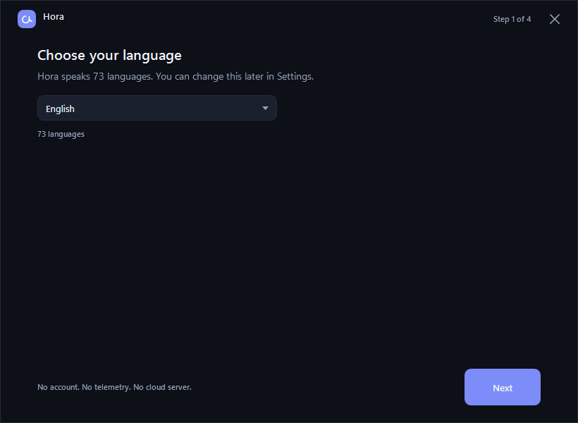

The first step lists all 73 catalogs with their native names and applies the
choice immediately.

### 2. Theme

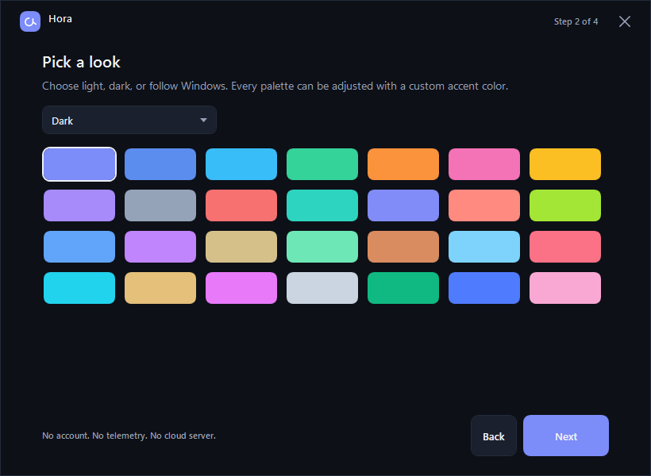

The second step previews the 28 palettes plus the custom accent field.

### 3. Welcome

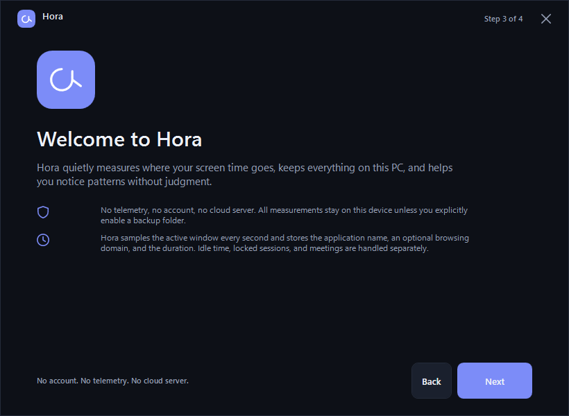

The third step explains local tracking and the privacy boundary.

### 4. Tour

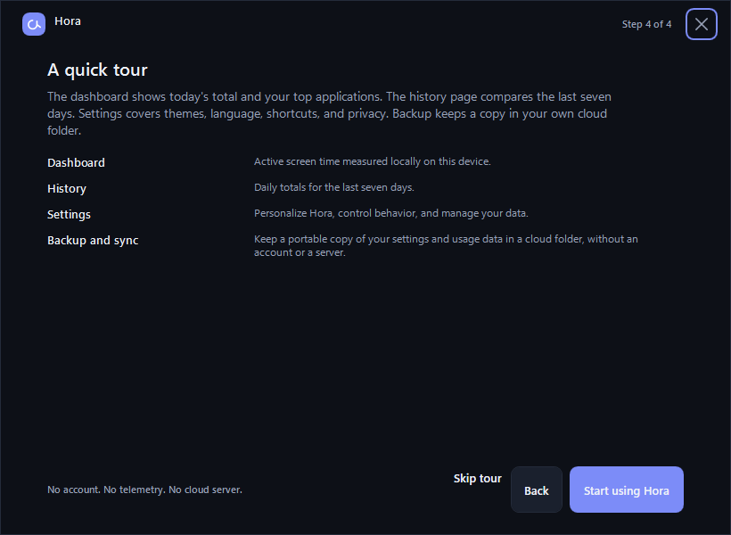

The fourth step points at the rail, the status bar, and the close behavior
choices before the main window opens.

## Main window

### 5. Dashboard

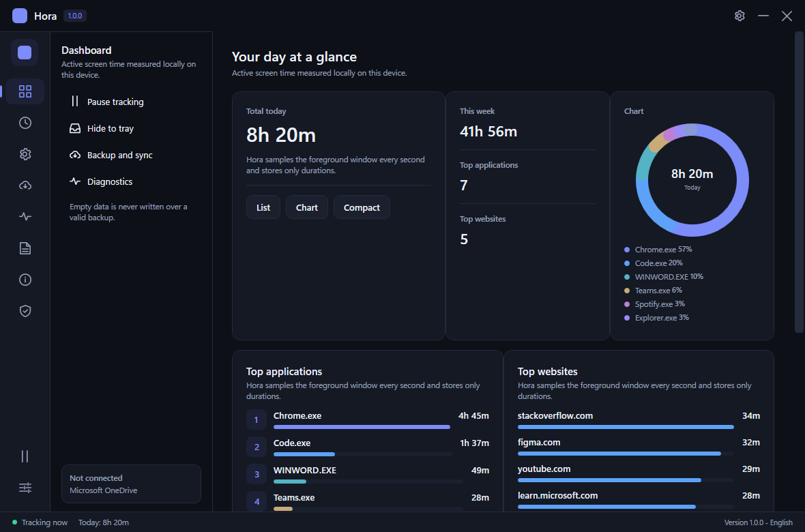

Today's total, application breakdown, top domains, weekly strip, and the
dashboard list or chart view.

### 6. History

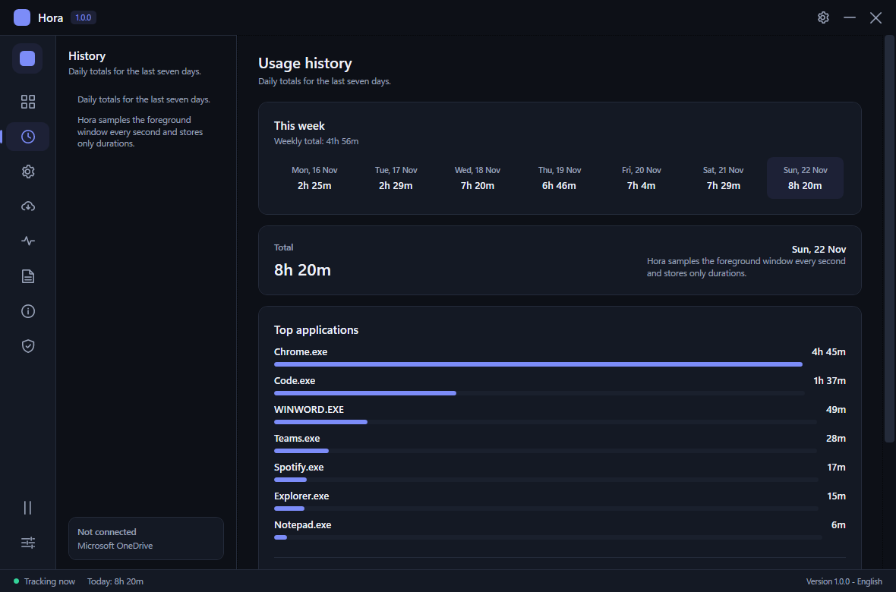

Seven-day totals, a day picker, and per-application detail for the selected
date.

### 7. Settings

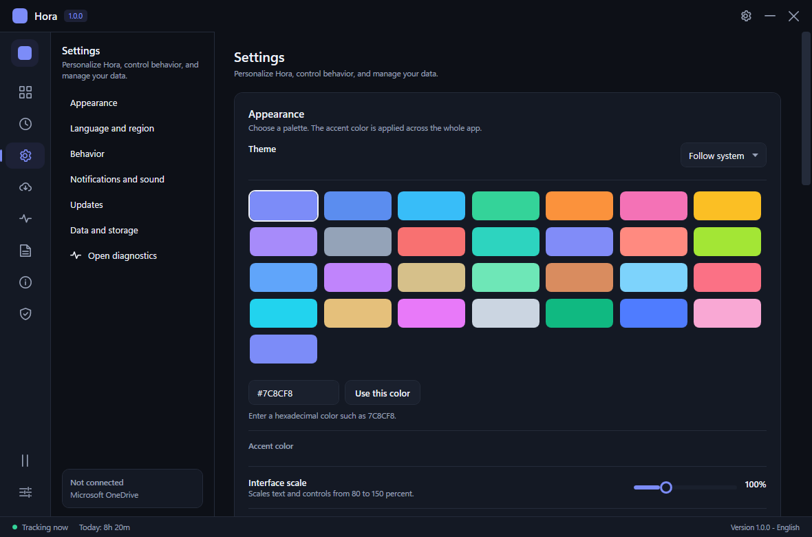

Language, theme, accessibility scale, startup, hotkey, notifications, backup,
and data controls in one scrollable page.

### 8. Backup

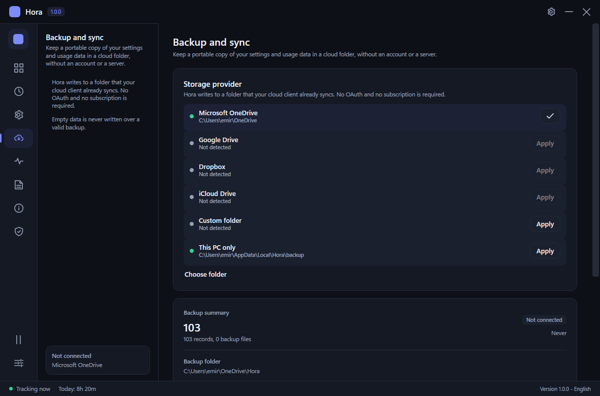

Provider detection, folder status, record counts, manual sync, restore, and the
rotation policy.

### 9. Diagnostics

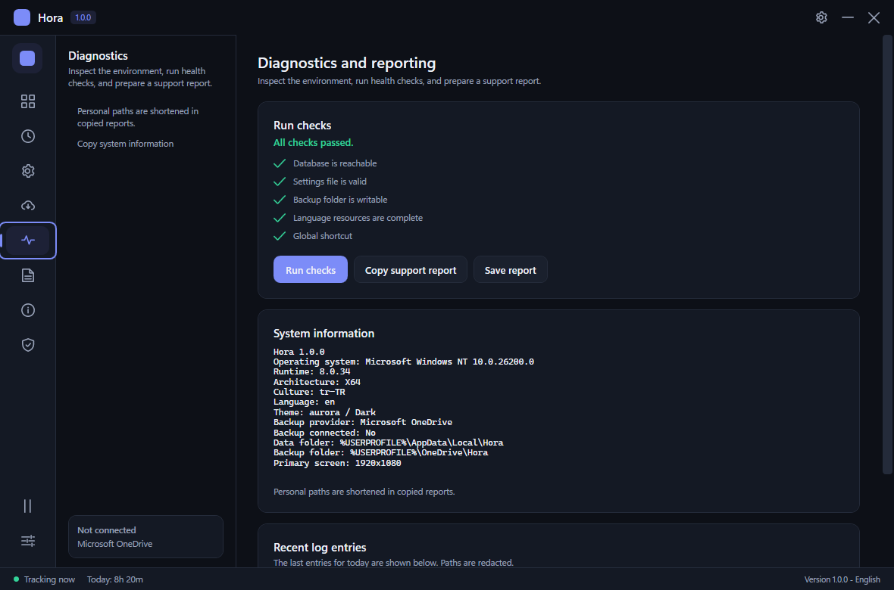

Version, runtime, database, log tail, one-click system information copy, and
the report export action. Log text is redacted before it is shown or copied.

### 10. Docs

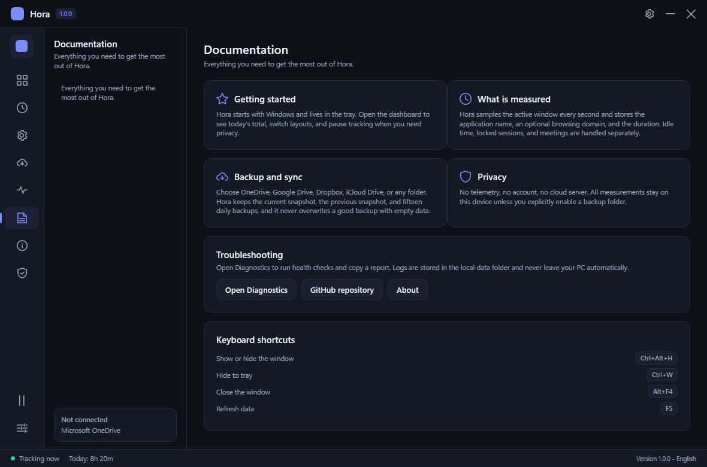

In-app quick start, tracking rules, backup behavior, and privacy notes.

### 11. About

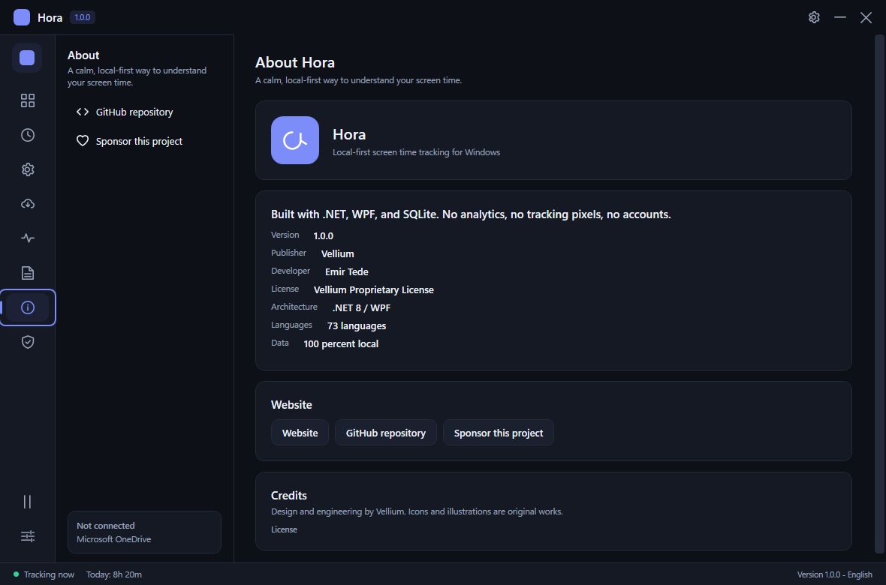

Product, publisher, version, architecture, license, and support links.

### 12. Legal

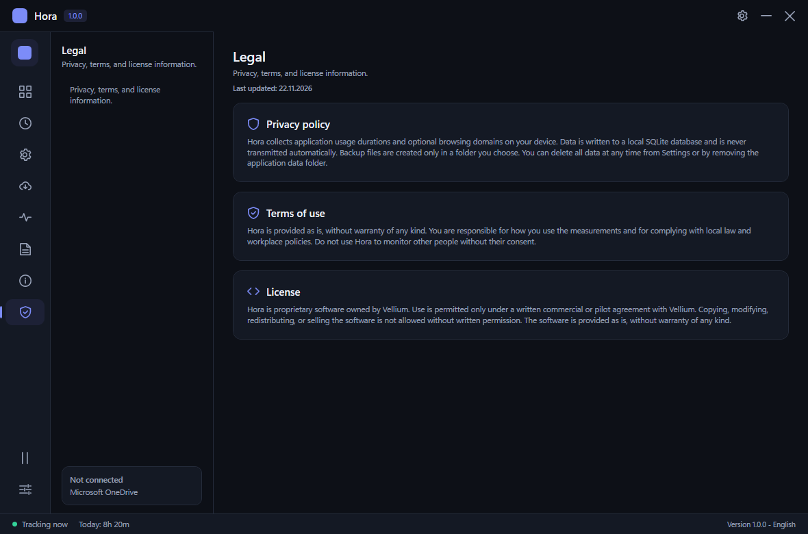

Privacy policy, terms of use, and the proprietary license summary.

## Visual acceptance checklist

- Window content fits 1180 x 780 with no clipped text or scrollbar overlap.
- Every label is localized; no English fallback appears when a non-English
  language is selected.
- Icons are vector geometry; no emoji or bitmap icon leaks.
- Both left and right edges of cards remain inside the content margin.
- Focus rings and hover states are visible in Light, Dark, and High Contrast.
